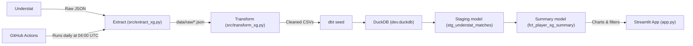

# ⚽ Premier League xG Analytics Engine

[](https://github.com/jtw0mey/pl-xg-data-pipeline/actions)


My first end-to-end data project: an automated ETL pipeline that collects Premier League Expected Goals data (xG, npxG, xGA), cleans and models it with dbt, and serves it through a live interactive Streamlit dashboard.

🚀 **Live Dashboard:** [pl-xg-data.streamlit.app](https://pl-xg-data.streamlit.app/)

---

## 👋 About This Project

This is my first ETL (Extract, Transform, Load) pipeline and my first project taken all the way from raw data to a deployed app. I chose football data because it's a big interest of mine, and it has clean, well-structured data sources available, which made it a great fit for a first project. I wanted to understand how a real data pipeline works from start to finish: collecting data from an external source, cleaning it, modelling it with SQL, automating updates, and presenting the results in a way people can explore.

---

## 🏗️ How the Pipeline Works



1. **Extract:** Pulls player and team data from Understat using the `understat` library with `asyncio` and `aiohttp`, and saves the raw JSON.
2. **Transform:** Uses Pandas to clean the data (for example, fixing HTML characters in player and club names) and calculates per-90 stats (xG/90, npxG/90, xGA/90) and xG overperformance (goals minus xG).
3. **Load:** `dbt seed` loads the season CSV files into tables in a local DuckDB database.
4. **Model with dbt:** SQL models organise the data in two layers:
   - A **staging model** (`stg_understat_matches`) combines the seasons into one table, sets the correct number types (goals, xG, minutes) and keeps column names consistent.
   - A **summary model** (`fct_player_xg_summary`) adds up each player's stats across seasons, including xG overperformance and non-penalty figures.
5. **Visualise:** A Streamlit app reads from the dbt summary model and uses Plotly charts to let you switch between seasons, filter by team and minutes played, toggle penalties on or off, and highlight individual players on a scatter plot.
6. **Automate:** A GitHub Actions workflow re-runs the pipeline every day at 04:00 UTC, so the data stays up to date.

---

## 🧪 Testing & Error Handling

**Python tests:** I added a few simple tests with `pytest` in `tests/test_transform.py`. They use a small sample of made-up data to check that the transformation step works as expected:

- Per-90 values are calculated correctly (`(xG / minutes) * 90`)
- xG overperformance (`goals - xG`) gives the right positive or negative result
- HTML characters like `&apos;` are cleaned out of player and club names

**dbt tests:** `dbt test` checks that the `player_id` column is never empty, so missing or broken records are caught before they reach the dashboard.

**Error handling:** I also added some basic error handling so a problem doesn't crash everything:

- If Understat is unavailable or sends back unexpected data, `extract_xg.py` logs a clear warning instead of failing with a confusing error.
- If new data couldn't be created, the dashboard shows a friendly message and keeps using the last working data, instead of showing a Python error.

---

## 🛠️ Tech Stack

- **Language:** Python 3.11
- **Data processing:** Pandas
- **Data modelling:** dbt
- **Database:** DuckDB
- **Data collection:** `understat`, `asyncio`, `aiohttp`
- **Dashboard:** Streamlit, Plotly
- **Testing:** pytest, dbt tests
- **Automation:** GitHub Actions
- **Hosting:** Streamlit Community Cloud

---

## 🤖 How I Used AI

I used AI assistants (Claude and Gemini) as development tools throughout this project, for help with writing and debugging code, explaining new concepts, and formatting documentation. I designed the project, made the technical decisions, ran and tested every stage of the pipeline, and worked through the problems that came up along the way. Working this way let me move quickly and build something complete, whilst learning how each part of the pipeline works.

---

## 📚 What I Learned

- How the Extract, Transform and Load stages fit together in a real pipeline
- Cleaning messy real-world data with Pandas
- Organising data into staging and summary models with dbt
- Writing SQL and working with a DuckDB database
- Scheduling automated jobs with GitHub Actions
- Building and deploying a dashboard with Streamlit
- Writing basic tests with pytest and dbt
- Handling errors so one problem doesn't break the whole pipeline

---

## 💻 Run It Locally

### Prerequisites

- Python 3.10+
- Git

### Installation

1. **Clone the repository:**

```bash
   git clone https://github.com/jtw0mey/pl-xg-data-pipeline.git
   cd pl-xg-data-pipeline
```

2. **Set up a virtual environment:**

```bash
   python3 -m venv venv
   source venv/bin/activate
```

3. **Install dependencies:**

```bash
   pip install -r requirements.txt
```

4. **Run the extraction and transformation:**

```bash
   python src/extract_xg.py
   python src/transform_xg.py
```

5. **Build and test the dbt models:**

```bash
   cd dbt_transforms
   dbt seed
   dbt run
   dbt test
   cd ..
```

6. **Launch the dashboard:**

```bash
   streamlit run app.py
```

7. **Run the Python tests:**

```bash
   pytest
```
