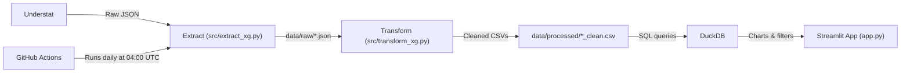

# ⚽ Premier League xG Analytics Engine

[](https://github.com/jtw0mey/pl-xg-data-pipeline/actions)


My first end-to-end data project: an automated ETL pipeline that collects Premier League Expected Goals data (xG, npxG, xGA), cleans and enriches it, and serves it through a live interactive Streamlit dashboard.

🚀 **Live Dashboard:** [pl-xg-data.streamlit.app](https://pl-xg-data.streamlit.app/)

---

## 👋 About This Project

This is my first ETL (Extract, Transform, Load) pipeline and my first project taken all the way from raw data to a deployed app. I chose football data because it's a big interest of mine, and it has clean, well-structured data sources available, which made it a great fit for a first project. I wanted to understand how a real data pipeline works from start to finish: collecting data from an external source, cleaning it, querying it with SQL, automating updates, and presenting the results in a way people can explore.

---

## 🏗️ How the Pipeline Works



1. **Extract:** Pulls player and team data from Understat using the `understat` library with `asyncio` and `aiohttp`, and saves the raw JSON.
2. **Transform:** Uses Pandas to clean the data (for example, fixing HTML characters in player and club names) and calculates per-90 stats (xG/90, npxG/90, xGA/90) and xG overperformance (goals minus xG).
3. **Load & Query:** Saves the cleaned data as CSV files. DuckDB runs SQL queries directly on those files, so no separate database server is needed.
4. **Visualise:** A Streamlit app with Plotly charts lets you switch between seasons, filter by team and minutes played, toggle penalties on or off, and highlight individual players on a scatter plot.
5. **Automate:** A GitHub Actions workflow re-runs the pipeline every day at 04:00 UTC, so the data stays up to date.

---

## 🛠️ Tech Stack

- **Language:** Python 3.11
- **Data processing:** Pandas, DuckDB
- **Data collection:** `understat`, `asyncio`, `aiohttp`
- **Dashboard:** Streamlit, Plotly
- **Automation:** GitHub Actions
- **Hosting:** Streamlit Community Cloud

---

## 🤖 How I Used AI

I used AI assistants (Claude and Gemini) as development tools throughout this project, for help with writing and debugging code, explaining new concepts, and formatting documentation. I designed the project, made the technical decisions, ran and tested every stage of the pipeline, and worked through the problems that came up along the way. Working this way let me move quickly and building something complete, whilst learning how each part of the pipeline works.

---

## 📚 What I Learned

- How the Extract, Transform and Load stages fit together in a real pipeline
- Cleaning messy real-world data with Pandas
- Writing SQL queries with DuckDB
- Scheduling automated jobs with GitHub Actions
- Building and deploying a dashboard with Streamlit

---

## 🔭 Next Steps

- Add tests for the transformation step
- Add more metrics, such as xA (expected assists)
- Improve error handling if the data source changes or is unavailable

---

## 💻 Run It Locally

### Prerequisites

- Python 3.10+
- Git

### Installation

1. **Clone the repository:**

```bash
   git clone https://github.com/jtw0mey/pl-xg-data-pipeline.git
   cd pl-xg-data-pipeline
```

2. **Set up a virtual environment:**

```bash
   python3 -m venv venv
   source venv/bin/activate
```

3. **Install dependencies:**

```bash
   pip install -r requirements.txt
```

4. **Run the pipeline and launch the dashboard:**

```bash
   python src/extract_xg.py
   python src/transform_xg.py
   streamlit run app.py
```